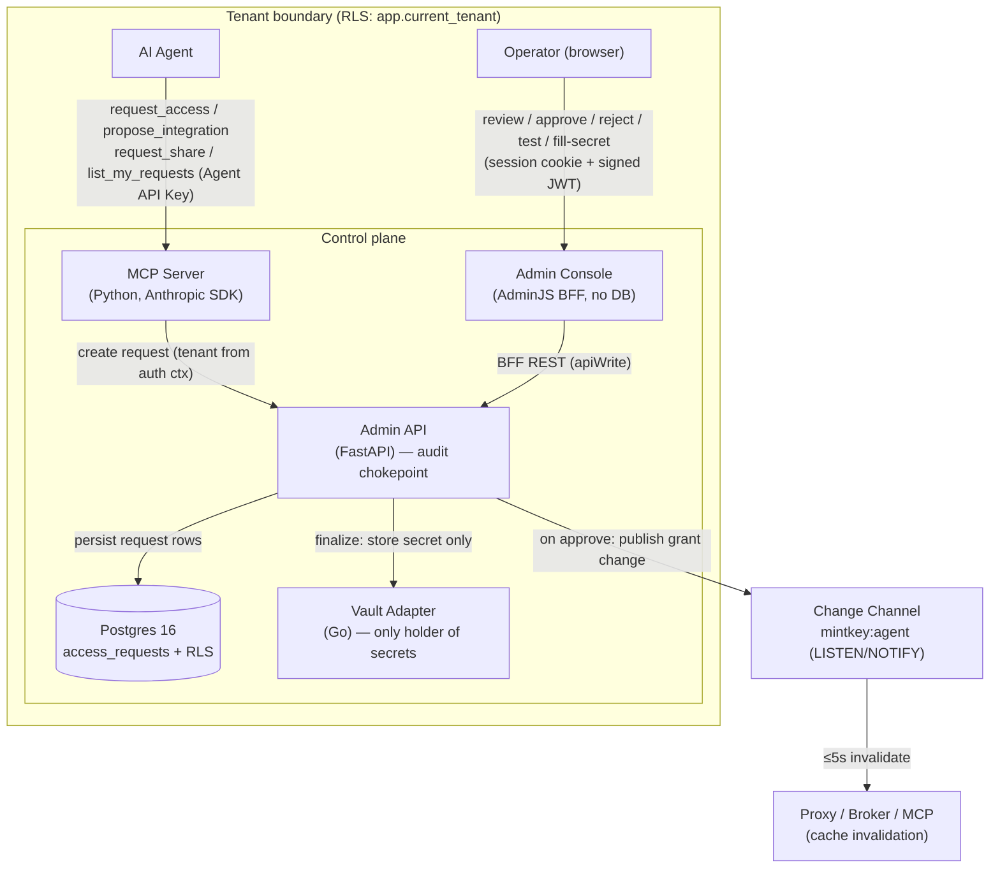
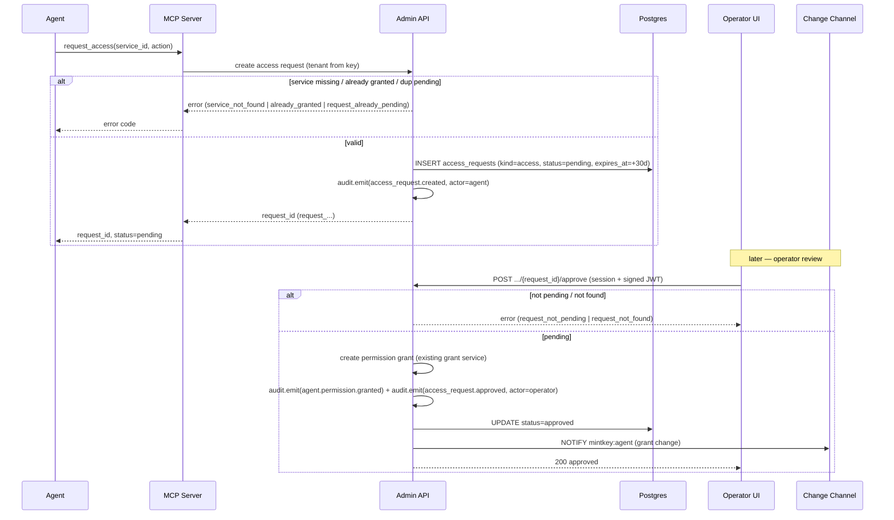
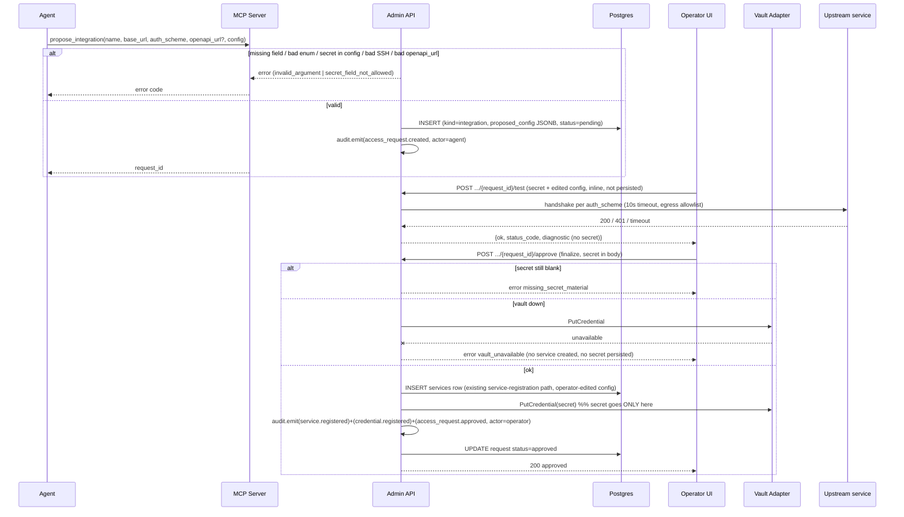
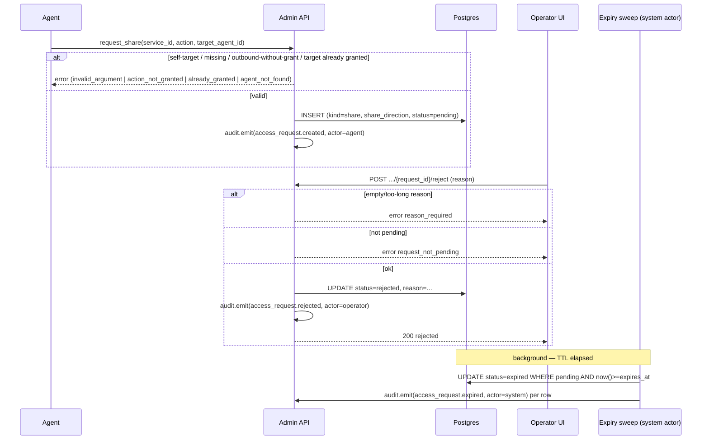
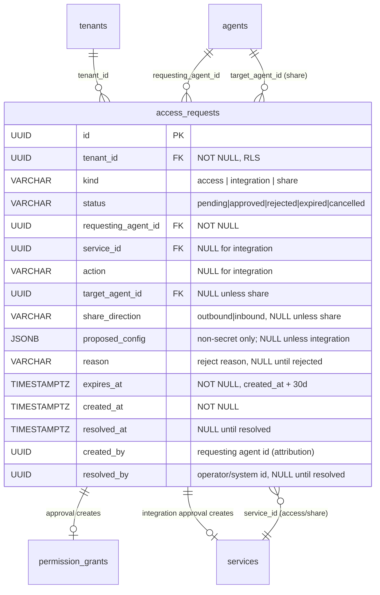
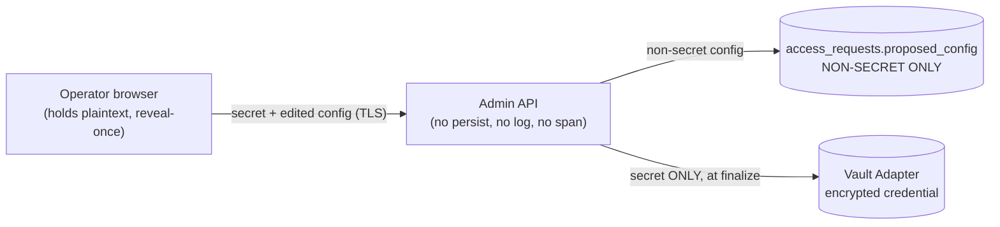
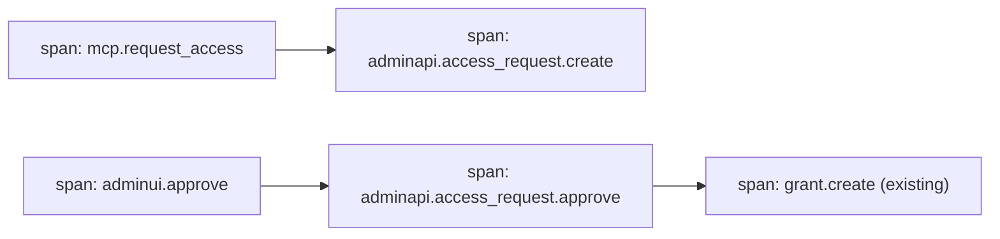

# Design Document: Agent Access Requests

## Overview

Agent Access Requests lets an autonomous agent ask a human operator — over MCP — for capabilities it does not yet have, and lets the operator resolve those asks from the Admin Console. Three request kinds share one umbrella row (`access_requests`, discriminated by `kind`):

1. **Access request** (`kind = access`) — a grant on a service that already exists in the tenant.
2. **Integration proposal** (`kind = integration`) — register a brand-new service. The agent supplies OpenAPI reference, `auth_scheme`, base URL, and *non-secret* config; the operator supplies the secret, may edit config, tests the connection, then finalizes.
3. **Share request** (`kind = share`) — extend access on an existing service to another agent (`outbound`) or ask for access owned by another agent (`inbound`).

The feature is **strictly additive** (Req 14): new tables, new REST paths, new MCP tools, new audit event types. It changes no existing wire surface and reuses the existing grant, service-registration, credential-storage, and audit machinery through their current interfaces. On approval it *calls* that machinery rather than reimplementing it.

### Mapping to the 15 requirements

| Req | Concern | Where addressed in this design |
|---|---|---|
| 1 | Access request creation + `list_my_requests` | MCP tool `request_access`; admin-api create service; §Components, §Wire contracts |
| 2 | Integration proposal (non-secret config, secret denylist, SSH rules, OpenAPI SSRF) | `propose_integration`; storage split §Data model; validation §Components |
| 3 | Share request (direction, validation) | `request_share`; `share_direction` column §Data model |
| 4 | Operator review list/detail | `GET .../access-requests`; Requests_Review_Area §Components |
| 5 | Approve access request → grant | approve endpoint reusing grant machinery §Components; §Sequence |
| 6 | Fill secret / edit / test / finalize integration | submit-secret + test + approve(finalize) §Components; Connection_Test §Components |
| 7 | Approve share request → grant to target | approve endpoint (share branch) §Components |
| 8 | Reject with reason | reject endpoint; `reason` column; UI block §Components |
| 9 | 30-day expiration | §Expiration mechanism (lazy-on-read + scheduled sweep) |
| 10 | Audit every state change | §Auditing; audit chokepoint, new event types |
| 11 | OTel coverage | §Auditing + OTel; trace propagation, metrics, allowlist |
| 12 | Multi-tenancy + RLS | §Data model (RLS policy in changeset); tenant GUC |
| 13 | Contract-first wire surfaces | §Wire contracts (OpenAPI 3.1, tools.yaml, audit schema, error codes) |
| 14 | Backwards compat + test isolation | §Backwards compatibility |
| 15 | Playwright headless e2e with artifacts | §Testing strategy |

### Design decisions and rationale

- **One table, three kinds.** A single `access_requests` table with a `kind` discriminator (rather than three tables) keeps the review list, RLS policy, expiration sweep, and audit `target_type` uniform. The kind-specific fields are nullable or live in one JSONB column. This is the smallest surface that satisfies all three flows (rule: smallest first cut).
- **Secret never lands on the request row.** The proposed *non-secret* config lives in `proposed_config JSONB` on the request row; the operator-supplied *secret* is sent straight to the Vault Adapter at finalize time and is never persisted on the row, logged, audited, or spanned (P-1, S-SEC-1, ADR-0017.6). This mirrors the reveal-once posture of ADR-0026 (operator-provisioned agent secrets) — the browser holds the plaintext, the server path is secret-free until the vault write.
- **Reuse, don't reimplement.** Approve calls the existing grant service; finalize calls the existing service-registration + credential path (the same code behind `POST /services` and the vault `PutCredential`). This satisfies Req 14.4 and gives us the existing `agent.permission.granted` / `service.registered` / `credential.registered` audit events for free.
- **No new `share_` row for MVP.** A share request is resolved by creating a normal `permission_grant` for the target agent. We do *not* introduce a distinct share-grant row, so we do *not* add a `share_` ULID prefix — only `request_` (ADR-0017.11). The distinction between outbound/inbound is a column on the request, not a new entity.

---

## Architecture

### Container view



The MCP Server and Admin Console are the two entry points; the Admin API is the single writer and the audit chokepoint (P-2). The Vault Adapter is the only component that ever holds operator-supplied secret material (P-1). Approval side effects fan out via the existing `mintkey:agent` change channel (ADR-0010) so the proxy/broker observe new grants within 5s (P-9).

### Sequence — Access request (create → approve, happy + error)



### Sequence — Integration proposal (propose → fill secret → test → finalize)



### Sequence — Share request + reject/expire error paths



---

## Data Models

### `access_requests` table

One table holds all three kinds. Kind-specific fields are nullable; integration-proposal config lives in a single JSONB column that **never** holds secret values.



Column notes:

- **`id`** is a UUID PK internally; the wire form is the `request_` prefixed ULID (`request_<26>`), matching how other tables map internal UUID ↔ prefixed-ULID on the wire (ADR-0017.11). The prefixed ULID is derived/stored consistently with the existing agent/service pattern (a `to_wire_id` helper already exists in `mintkey-models`).
- **`kind`** / **`status`** / **`share_direction`** are `VARCHAR` with a `CHECK` constraint enumerating the allowed values (matches the project's enum-as-checked-varchar convention; no Postgres `ENUM` types are used elsewhere).
- **`proposed_config`** holds only non-secret fields (`client_id`, `token_url`, `ssh_user`, `header_name`, `base_url`, `openapi_url`, `auth_scheme`, `actions`, …). The **secret-field denylist** (`*_secret`, `*_password`, `*_passphrase`, `private_key`, `token`, `api_key`) is rejected at create time (Req 2.4) so a secret value can never be written here. This is the storage split that keeps secrets out of the row (Req 6.1).
- **`reason`** ≤ 1000 chars, populated only on reject (Req 8.1–8.2).
- **`expires_at`** set to `created_at + INTERVAL '30 days'` (Req 9.1); the sweep and lazy-check both compare against it.

### Storage split — where the secret goes



The request row is created by the agent and carries only non-secret proposed config. The secret is introduced later by the operator and flows browser → admin-api → Vault Adapter without ever touching the row, logs, audit payloads, or OTel spans (Req 6.1, 6.7; P-1; ADR-0017.6). Handlers on this path set `x-mintkey-sensitive` and are excluded from body logging (ADR-0026 D7 precedent).

### RLS and Liquibase placement

- New changeset **`030-access-requests.yaml`** under `apps/admin-api/db/changelog/` (next free number; `029` is taken twice already — `029-budget-counters.yaml` and `029-oidc-login-state.yaml` — so this feature uses `030`). Registered in `db.changelog-master.yaml`.
- The changeset creates the table, its `tenant_id` FK, the supporting indexes (`idx_access_requests_tenant`, a partial index on `(tenant_id, status)` for the pending-list and sweep), enables RLS, and creates the `tenant_isolation` policy **in the same changeset** (P-3, ADR-0008), following the exact pattern in `027-agent-secrets.yaml`:

  ```sql
  ALTER TABLE public.access_requests ENABLE ROW LEVEL SECURITY;
  CREATE POLICY tenant_isolation ON public.access_requests
    USING (
      tenant_id = current_setting('app.current_tenant', true)::uuid
      OR current_setting('app.platform_admin_view', true) = 'on'
    );
  GRANT SELECT, INSERT, UPDATE, DELETE ON public.access_requests TO mintkey_app;
  ```

- Idempotent changesets guarded by `preConditions … onFail: MARK_RAN` (project convention).

### SQLAlchemy mirror

A new `AccessRequest` `Mapped` model is added to `packages/python/mintkey-models` mirroring the **introspected** Liquibase schema — it does not define it (P-8, ADR-0015). The CI `sqlacodegen` diff must pass. Pydantic v2 request/response models sit alongside it in the admin-api service layer.

---

## Wire Contracts (contract-first, P-4)

All surfaces are defined in the canonical contracts **before** implementation. FastAPI emits OpenAPI that the CI round-trip diff checks against the checked-in YAML (Req 13.5–13.6).

### New REST endpoints (`docs/architecture/contracts/rest/openapi.yaml`, OAS 3.1)

All under `/v1/tenants/{tenant_id}/access-requests`. Nullable fields use `type: [<T>, "null"]` (never `nullable: true`) per ADR-0017. State-changing routes require `AdminUiSignedRequest` + operator session (ADR-0019).

| Method | Path | Purpose | Req |
|---|---|---|---|
| `GET` | `/access-requests` | List, filter by `status` & `kind`, order `created_at desc` | 4.1–4.3 |
| `GET` | `/access-requests/{request_id}` | Full detail (integration shows blank secret fields) | 4.4, 4.6 |
| `POST` | `/access-requests/{request_id}/approve` | Approve access/share; **finalize** integration (secret in body for integration) | 5, 6.5, 7 |
| `POST` | `/access-requests/{request_id}/reject` | Reject with `reason` | 8 |
| `POST` | `/access-requests/{request_id}/test` | Connection_Test for an integration proposal (secret + edited config inline, not persisted) | 6.3–6.4 |

Response shape (list item / detail, OAS 3.1 conceptual):

```yaml
AccessRequest:
  type: object
  required: [request_id, kind, status, requesting_agent_id, created_at, expires_at]
  properties:
    request_id:          { type: string, pattern: "^request_[0-9A-HJKMNP-TV-Z]{26}$" }
    kind:                { type: string, enum: [access, integration, share] }
    status:              { type: string, enum: [pending, approved, rejected, expired, cancelled] }
    requesting_agent_id: { type: string, pattern: "^agent_[0-9A-HJKMNP-TV-Z]{26}$" }
    service_id:          { type: [string, "null"] }
    action:              { type: [string, "null"] }
    target_agent_id:     { type: [string, "null"] }
    share_direction:     { type: [string, "null"], enum: [outbound, inbound, null] }
    proposed_config:     { type: [object, "null"] }   # non-secret only
    reason:              { type: [string, "null"] }
    created_at:          { type: string, format: date-time }
    expires_at:          { type: string, format: date-time }
```

The `approve` body for an integration carries the operator secret (`credential_value` + per-scheme secret fields) and the possibly-edited config; it is marked `x-mintkey-sensitive` and never logged. The `test` endpoint reuses the semantics of the existing `POST /services/test-transient` (validate a candidate config + credential inline without persisting), which is the established secret-free-diagnostic precedent.

### New MCP tools (`docs/architecture/contracts/mcp/tools.yaml`)

Four tools; **none** declares a `tenant_id` argument (tenant resolved from the Agent API Key auth context, ADR-0009, Req 13.2):

- **`request_access`** — input `{ service_id, action }`; output `{ request_id, status }`.
- **`propose_integration`** — input `{ name, base_url, auth_scheme, openapi_url?, config }`; output `{ request_id, status }`. `auth_scheme` references the existing closed `#/$defs/auth_scheme` enum.
- **`request_share`** — input `{ service_id, action, target_agent_id }`; output `{ request_id, status, share_direction }`.
- **`list_my_requests`** — input `{ status?, kind?, after?, limit? }`; output `{ requests: [ {request_id, kind, status, created_at, expires_at} ], next_cursor }`.

### New audit event types (`docs/architecture/contracts/events/audit-event.schema.json`)

Add `target_type` value **`access_request`** to the closed enum, and define event types conforming to the existing envelope + per-tenant hash chain (`prev_hash` + `hash`):

- `access_request.created` (actor: `agent`)
- `access_request.approved` (actor: `operator`)
- `access_request.rejected` (actor: `operator`) — payload carries `reason`
- `access_request.expired` (actor: `system`)

Payloads are identifier/metadata-only: `request_id`, `kind`, `status`, and target references. **No secret material, no denylisted field values** (Req 10.3). On approval the handler *additionally* emits the existing `agent.permission.granted` / `service.registered` / `credential.registered` events within the same audited operation (Req 10.4).

### New error codes (Req 13.3)

Added to the closed `mintkey:code` enum in `openapi.yaml` **and** the `error_code` enum in `tools.yaml` so every code the feature returns is a member of both:

`request_not_found`, `request_not_pending`, `already_granted`, `request_already_pending`, `secret_field_not_allowed`, `missing_secret_material`, `reason_required`.

Existing codes reused unchanged: `service_not_found`, `agent_not_found`, `action_not_granted`, `invalid_argument` (REST maps to `validation_failed` per ADR-0017.10), `vault_unavailable`.

---

## Components and Interfaces

### Admin API (`apps/admin-api/`)

- **Router** `api/access_requests.py` — the five REST endpoints above, mounted alongside existing routers. Reads set the tenant GUC from the validated session; writes additionally require the signed request (ADR-0019) and derive effective identity (audit `actor_id`, tenant GUC) from the **session**, not the JWT body.
- **Service** `services/access_requests.py` — business logic: create (with all Req 1/2/3 validations), list/get, approve (branches by `kind`), reject, test, expire. Approve/finalize call the **existing** grant service and service-registration/credential paths; no duplication (Req 14.4).
- **Audit** — every state change goes through the single `audit.emit()` helper inside the same DB transaction; if the audit write fails the transaction rolls back so no status change, grant, service, or credential persists without its audit event (Req 10.6, P-2).

### MCP Server (`apps/mcp-server/`)

One handler file per tool under `tools/` (`request_access.py`, `propose_integration.py`, `request_share.py`, `list_my_requests.py`), following the existing tool pattern. Each resolves `agent_id`/`tenant_id` from the Bearer Agent API Key context and calls admin-api (or shares its service layer per the existing MCP↔admin-api arrangement). No tenant argument is accepted.

### Admin Console — Requests_Review_Area (`apps/admin-ui/`)

- A dedicated AdminJS navigation section **clearly separated** from Services/Agents/Permissions (Req 4.5). Implemented as an AdminJS resource backed by the BFF (no DB connection, ADR-0019), same BFF pattern as `budget-management-ui`.
- **List page** — pending requests with `kind`, `status`, requesting agent, target summary, `created_at`, `expires_at`; filters for `status` and `kind`.
- **Detail page** — full request; for an integration proposal it renders proposed non-secret config plus **empty, operator-supplied-labelled** secret inputs (Req 4.6, 6.8).
- **Actions** — Approve; Reject (a reason textbox that **blocks submission when empty**, Req 8.5); and for integrations: editable config fields, a **Test connection** control showing the Connection_Test result, and a **Finalize** control **enabled only after required secrets are supplied** (Req 6.8).
- **BFF routes** under `/admin/api/access-requests/*` proxy to admin-api via `apiWrite()` (session cookie + signed JWT); secret-bearing bodies are not logged.

### Connection_Test service

Triggered by `POST .../{request_id}/test`. It performs an upstream handshake using the operator-supplied secret + (possibly edited) config, per `auth_scheme`, with a **10-second timeout** (Req 6.3–6.4), reusing the existing transient-test machinery behind `POST /services/test-transient`:

- REST/API schemes (`api_key_header`, `bearer_token`, `oauth2_client_credentials`, …): build the authenticated request and hit a health/base path; report `{ok, status_code, latency_ms, diagnostic}`.
- SSH schemes (`ssh_private_key`, `ssh_password`, `ssh_ca`): open a TCP+SSH handshake to `ssh://host:port` from `base_url` (ADR-0023; no `target_address`).
- The secret is used in-process only; the returned diagnostic contains **no secret material** (Req 6.3), and egress allowlisting (ADR-0007) + timeout produce a fail result on forbidden/slow destinations.

---

## Expiration Mechanism (Req 9)

**Chosen approach: lazy-on-read guard + scheduled sweep (both).**

- **Lazy-on-read** — any read or mutation that loads a `pending` request whose `now() >= expires_at` treats it as `expired`; approve/reject on such a row returns `request_not_pending` (Req 9.5) and the read reflects `expired`. This guarantees no expired request is ever actioned, independent of sweep timing.
- **Scheduled sweep** — a periodic job flips `pending → expired` for elapsed rows and emits one `access_request.expired` audit event per row with `actor_type: system` (Req 9.2, 10.5). This keeps the stored status accurate for the review list and audit chain rather than relying only on read-time inference.

**Justification.** Lazy-on-read alone would leave the persisted status stale (`pending` forever) and would never emit the system-actor expiry audit event that Req 10.1 requires. A sweep alone has a propagation lag window during which a just-expired row could be actioned. Combining them gives correctness (lazy guard) plus a complete audit trail and accurate list state (sweep). The repo already runs scheduled jobs — the **`audit-verify-job`** (per `apps/audit-verify-job/`) is the precedent — so a small `access-request-expiry-job` (or a cron task within admin-api) fits the existing operational model. The sweep runs the expiry inside the admin-api audit chokepoint so the `access_request.expired` event goes through `audit.emit()` like every other state change.

---

## Auditing + OpenTelemetry Design (Req 10, 11)

### Audit emission points

`created` (agent), `approved` (operator), `rejected` (operator), `expired` (system). Approval additionally emits the reused `agent.permission.granted` / `service.registered` / `credential.registered` in the same transaction. All go through the single `audit.emit()` chokepoint, extend the per-tenant hash chain (`prev_hash`+`hash`), and roll back the state change on audit failure (P-2, ADR-0014.7).

### Tracing

A single trace spans MCP → admin-api → admin-ui approval:



W3C `traceparent` is propagated on the MCP→admin-api call and the admin-ui→admin-api call so the spans share one trace ID and are retrievable as one trace (Req 11.1). The `trace_id` is also stamped on the audit envelope (existing `trace_id` field).

### Metrics

Counters incremented on each transition, labelled `kind` and `tenant_id` (Req 11.2): `access_request_created_total`, `_approved_total`, `_rejected_total`, `_expired_total`.

### Attribute allowlist enforcement

Span attributes are restricted to the allowlist; any value matching `*_token`, `*_secret`, `*_password`, `*_passphrase`, `Authorization`, `Cookie` is forbidden and omitted (Req 11.3, 11.5; ADR-0017.6). Structured JSON logs on transition carry `request_id`, `kind`, `status` only (Req 11.4). The existing CI red-team grep covers these paths.

---

## Correctness Properties

*A property is a characteristic or behavior that should hold true across all valid executions of a system — essentially, a formal statement about what the system should do. Properties serve as the bridge between human-readable specifications and machine-verifiable correctness guarantees.*

The following properties are derived from the acceptance-criteria prework and consolidated to remove redundancy (e.g. the secret-leakage criteria across Req 6/10/11 collapse into one comprehensive property; the tenant-isolation criteria across Req 4/5/8/12 collapse into one).

### Property 1: The operator secret never leaks anywhere secret-free

*For any* operator-supplied secret value used to submit, test, or finalize an integration proposal, after the operation completes the secret value SHALL NOT appear in the `access_requests` row (including `proposed_config`), in any structured log entry, in any audit event payload, in any OTel span attribute, in the Connection_Test diagnostic message, or in any response visible to the agent — and if the Vault Adapter is unavailable, no service, credential, or secret SHALL be persisted anywhere.

**Validates: Requirements 6.1, 6.3, 6.7, 10.3, 11.3, 11.5**

### Property 2: Tenant isolation holds for every cross-tenant reference

*For any* `request_id` belonging to a different tenant, every read and every mutation (get, approve, reject, test) evaluated under the caller's tenant context SHALL respond as though the request does not exist (`request_not_found`) and SHALL perform no state change; and *for any* request-touching operation with no resolvable tenant context, the operation SHALL be rejected rather than executed.

**Validates: Requirements 4.4, 5.5, 8.6, 12.2, 12.3, 12.4**

### Property 3: Approve and reject are legal only from `pending`

*For any* request whose `status` is not `pending` (`approved`, `rejected`, `expired`, `cancelled`), an approve or reject action SHALL be rejected with `request_not_pending`, SHALL create no grant/service/credential, and SHALL leave the existing `status` and `reason` unchanged.

**Validates: Requirements 5.6, 7.4, 9.5**

### Property 4: Terminal requests produce no side artifacts

*For any* request that reaches `rejected` or `expired`, no permission grant, service, or credential SHALL exist as a result of that request.

**Validates: Requirements 8.3, 9.4**

### Property 5: Approving a pending grant-request yields exactly the requested grant

*For any* pending access request `(requesting_agent, service, action)`, approval SHALL create exactly one permission grant for `(requesting_agent, service, action)` and set the request `status` to `approved`; and *for any* pending outbound/inbound share request `(target_agent, service, action)`, approval SHALL create exactly one permission grant for `(target_agent, service, action)` and set `status` to `approved`.

**Validates: Requirements 5.1, 7.1**

### Property 6: Approval is idempotent when the grant already exists

*For any* pending share request whose target grant `(target_agent, service, action)` already exists at approval time, approval SHALL set the request `status` to `approved` without creating a duplicate grant (exactly one grant remains).

**Validates: Requirements 7.5**

### Property 7: The config secret-denylist gate rejects any secret field

*For any* integration proposal `config` object, the proposal SHALL be rejected with `secret_field_not_allowed` if and only if at least one key matches the secret denylist (`*_secret`, `*_password`, `*_passphrase`, `private_key`, `token`, `api_key`); when no key matches, the non-secret fields SHALL be accepted and stored on `proposed_config`.

**Validates: Requirements 2.4**

### Property 8: Operator config edits override agent-proposed values

*For any* integration proposal where the operator edits one or more non-secret config fields before finalizing, the created service SHALL reflect the operator's edited values in place of the agent-proposed values.

**Validates: Requirements 6.2**

### Property 9: Expiration boundary is exact and 30 days

*For any* created request, `expires_at` SHALL equal `created_at` plus exactly 30 days (RFC 3339 UTC); and *for any* pending request evaluated at time `t`, its effective status SHALL be `expired` if and only if `t >= expires_at`, and `pending` while `t < expires_at`.

**Validates: Requirements 9.1, 9.2, 9.3**

### Property 10: Every state change emits its audit event through the chokepoint

*For any* request state transition (created, approved, rejected, expired) — and additionally for any approval that creates a grant, service, or credential — the corresponding audit event(s) (`access_request.created/approved/rejected/expired` plus, on approval, `agent.permission.granted` / `service.registered` / `credential.registered`) SHALL be emitted via the single `audit.emit()` chokepoint and extend the tenant's hash chain.

**Validates: Requirements 5.4, 7.1, 10.1, 10.4**

### Property 11: Audit actor type matches the trigger

*For any* emitted request audit event, `actor_type` SHALL be `agent` for agent-initiated creation, `operator` for operator approve/reject (with operator identity derived from the validated session), and `system` for expiration.

**Validates: Requirements 10.5**

### Property 12: Audit failure aborts the state change atomically

*For any* request state transition in which the audit event cannot be emitted, no request status update, permission grant, service, or credential SHALL be persisted.

**Validates: Requirements 10.6**

### Property 13: Created requests have the correct kind-specific shape

*For any* successfully created request: an access request SHALL have `kind = access`, `status = pending`, a non-null `(service_id, action)`, and null `proposed_config`; an integration proposal SHALL have `kind = integration`, null `service_id`, and a non-null `proposed_config` with no `services` row created; a share request SHALL have `kind = share`, a non-null `service_id`, a `share_direction` of `outbound` or `inbound`, and null `proposed_config`.

**Validates: Requirements 1.1, 2.7, 3.1, 3.2, 3.9**

### Property 14: Invalid create/reject inputs are rejected with no row change

*For any* create call missing or supplying an empty/whitespace required field (access: `service_id`/`action`; integration: `name`/`base_url`/`auth_scheme`, out-of-enum `auth_scheme`, SSH `base_url` not `ssh://host:port`, SSH with `target_address`; share: `service_id`/`action`/`target_agent_id`, self-target, outbound without the requester's grant, target already granted), the request SHALL be rejected with the specified error code and SHALL create no row; and *for any* reject call whose `reason` is missing, empty, whitespace-only, or longer than 1000 characters, the call SHALL be rejected with `reason_required` and SHALL leave the request unchanged.

**Validates: Requirements 1.3, 1.5, 2.2, 2.3, 2.5, 2.6, 3.3, 3.4, 3.7, 3.8, 8.2**

### Property 15: Listing returns the correct tenant-scoped, filtered, ordered subset

*For any* set of requests and any valid `status`/`kind` filters, the operator list SHALL return exactly the tenant's requests matching the filters ordered by `created_at` descending with the required fields; and *for any* agent, `list_my_requests` SHALL return exactly that agent's requests scoped to its tenant.

**Validates: Requirements 1.7, 4.1, 4.2, 8.4**

### Property 16: Duplicate pending requests are rejected

*For any* Requesting_Agent and `(service_id, action)`, once a pending access request exists, a second identical create SHALL be rejected with `request_already_pending` and SHALL leave exactly one such row.

**Validates: Requirements 1.6**

---

## Error Handling

| Scenario | Layer | Behavior |
|---|---|---|
| Missing/empty required create field | admin-api | `400 invalid_argument` (MCP) / `422 validation_failed` (REST), no row |
| Config carries a denylisted secret field | admin-api | `secret_field_not_allowed`, names the offending field, no row |
| `openapi_url` not HTTPS or SSRF-blocked | admin-api | `invalid_argument`, no row |
| Referenced service/agent absent in tenant | admin-api | `service_not_found` / `agent_not_found`, no row |
| Requester already holds grant / duplicate pending | admin-api | `already_granted` / `request_already_pending`, no row |
| Approve/reject a non-pending request | admin-api | `request_not_pending`, status + reason unchanged |
| Cross-tenant `request_id` | admin-api | `request_not_found` (no cross-tenant reveal) |
| Reject without valid reason | admin-api | `reason_required`, unchanged; UI blocks submission |
| Finalize with blank secret | admin-api | `missing_secret_material`, no service |
| Vault Adapter unavailable on submit/finalize | admin-api | `vault_unavailable`, no service, no secret persisted anywhere |
| Connection_Test upstream timeout (>10s) | admin-api | fail result, diagnostic notes timeout, no secret in message |
| Missing/mismatched session or signed JWT | admin-api | `401 unauthenticated` / `403`, no state change |
| Audit emission fails | admin-api | transaction rolls back; no orphaned state change (P-2) |

All errors use RFC 7807 `application/problem+json` with `mintkey:code` + `mintkey:trace_id` on REST; MCP tools return the `error_code` enum. Every code the feature emits is a member of both closed enums (Req 13.3).

---

## Testing Strategy

Property-based testing **is** applicable to this feature: the create/validation logic, the secret-denylist gate, the state-machine transitions, the tenant-isolation invariant, and the expiration boundary are all pure, input-varying behaviors with meaningful universal statements. The Admin Console rendering and the cross-service wiring (trace propagation, change-channel publish, contract round-trip, RLS coverage) are **not** PBT-suitable and are covered by integration, architecture, and Playwright tests instead.

All tests are **add-only**. No existing test is modified, renamed, or deleted (Req 14.2–14.3).

### Property-based tests (Python: `hypothesis`; the repo already uses it — see `.hypothesis/`)

Each property test runs a **minimum of 100 iterations** and is tagged:
`# Feature: agent-access-requests, Property {N}: {property_text}`

- **P1 (secret never leaks)** — generate high-entropy secret canaries; run submit/test/finalize (and a vault-down variant) against testcontainers Postgres + a stub Vault; assert zero canary matches across the row, structured logs, emitted audit payloads, captured span attributes, the test diagnostic, and any agent-visible response. This is the red-team property and pairs with the CI red-team grep.
- **P2 (tenant isolation)** — fuzz cross-tenant `request_id`s and missing-GUC transactions across all reads + mutations; assert `request_not_found` / rejection and no state change.
- **P3 (state-machine legality)**, **P4 (no terminal artifacts)**, **P5 (approve → exact grant)**, **P6 (approval idempotence)** — generate requests across statuses and grant pre-conditions; assert transition legality and grant outcomes.
- **P7 (denylist gate)**, **P8 (config-edit override)**, **P13 (create shape)**, **P14 (invalid-input rejection)**, **P16 (duplicate pending)** — generate configs/inputs mixing valid + denylisted keys, valid + invalid required fields, SSH variants; assert accept/reject.
- **P9 (expiration boundary)** — generate creation times and evaluation times around `expires_at`; assert the 30-day delta and the `t >= expires_at` boundary.
- **P10 (audit coverage)**, **P11 (actor type)**, **P12 (audit atomicity)** — drive each transition; assert the audit event(s), `actor_type`, and (with an injected audit failure) full rollback.
- **P15 (list filter/order/scope)** — seed mixed requests; assert filtered, ordered, tenant-scoped subsets for both the operator list and `list_my_requests`.

### Unit tests

Concrete examples and edge cases for the pure helpers: the secret-denylist matcher, the `ssh://host:port` validator, the `openapi_url` HTTPS/SSRF check, the RFC-3339 `expires_at` computation, and the `request_` ULID formatter. Admin-ui utilities (reason-required guard, finalize-enabled guard) via `vitest`.

### Integration tests (`testcontainers`)

- Approve publishes a grant change on `mintkey:agent` observed within 5s (Req 5.7, 7.2); revoke publishes `agent.permission.revoked` (Req 7.6).
- Connection_Test against a stub upstream: pass, `401`, and 10s timeout → fail (Req 6.3–6.4).
- Auth: missing/mismatched session vs signed JWT → unauthorized, no change (Req 5.2–5.3).
- Single trace ID across MCP → admin-api → admin-ui approval (Req 11.1); metric counters increment per transition (Req 11.2).

### Architecture tests

- **RLS coverage** — `access_requests` appears in `pg_policies` with a `tenant_isolation` policy referencing `current_setting('app.current_tenant')` (extends the existing `tests/architecture/test_rls_coverage.py`, add-only) (Req 12.1).
- **Audit coverage** — the new state-change handlers route through `audit.emit()` (extends `test_audit_coverage.py`, add-only) (Req 10.1).
- **Contract conformance** — `openapi-spec-validator` on the updated OpenAPI; every feature error code is a member of both the `mintkey:code` and `tools.yaml` `error_code` enums; the CI OpenAPI round-trip diff reports no drift (Req 13.1–13.6).
- **SQLAlchemy mirror diff** — `sqlacodegen` diff passes after the `030` changeset (Req 12.5–12.6).
- **Red-team grep** — secret fingerprints absent from all log/span emissions on this path (pairs with P1).

### Mandatory Playwright headless e2e (Req 15)

A **new** Playwright spec under the repo's UI test location, aligned with `.github/workflows/playwright.yml` (no existing test touched, Req 15.9). It:

1. Logs into the Admin Console and navigates to the Requests_Review_Area; fails if that is not reached within 30s (Req 15.2–15.3).
2. Asserts the pre-seeded pending request is rendered by its `request_id` with status "pending" (Req 15.4).
3. **Approve case** — exercises Approve, asserts the displayed status changes to "approved" (Req 15.5).
4. **Reject-with-reason case** (separate test) — submits a non-empty reason, asserts status changes to "rejected" and the reason is displayed (Req 15.6).
5. Captures **screenshot + Playwright trace** artifacts at (a) first-visible pending and (b) post-action status, uploaded as retained CI artifacts a reviewer can open (Req 15.7–15.8).
6. Fails if the Requests_Review_Area or its Approve/Reject controls are absent or non-functional (Req 15.10).

---

## Backwards Compatibility and Rollout

- **Add-only surfaces.** New table (`030` changeset), new REST paths, new MCP tools, new audit event types + `target_type`, new error codes. No existing endpoint, tool, table, audit event, request/response schema, or behavior changes (Req 14.1).
- **Reuse via existing interfaces.** Approve/finalize call the existing grant, service-registration, and credential machinery through their current signatures and semantics — no forks, no signature changes (Req 14.4).
- **Test isolation.** All new tests; existing suite runs unchanged with zero new failures and zero newly-skipped tests (Req 14.2–14.3). The architecture tests are *extended additively* (new assertions appended), not rewritten.
- **Blocking-issue rule.** If implementation reveals that delivering a requirement would force a change to an existing wire surface, schema, or test, that is surfaced to the maintainer as a blocking issue rather than applied silently (Req 14.5) — logged as an `OQ-NNN` in `docs/architecture/01-architecture/open-questions.md`.
- **Rollout.** The `030` Liquibase changeset runs on deploy (idempotent, `MARK_RAN`-guarded). The expiry job (or admin-api cron task) is enabled with the feature. The Admin Console gains the new navigation section; because the BFF holds no DB connection, the UI change is a pure additive resource + route set (ADR-0019). Contracts land first (P-4); the CI round-trip diff gates the implementation against them.
